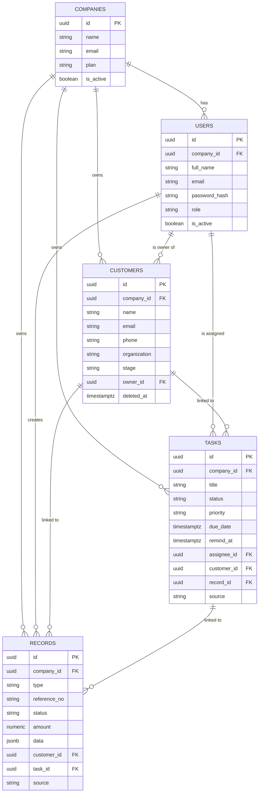

# AI Employee OS: Backend APIs and Database
## Day 1 (Research) + Day 2 (Design)

**Owner:** Hadeed Ul Hassan (Hadi)
**Role:** Backend APIs and Database
**Scope:** users, customers, tasks, records
**Status:** Draft v1, shared with the team for feedback

---

## Table of Contents

1. [What my role must deliver](#1-what-my-role-must-deliver)
2. [Understanding the project (from the PDF)](#2-understanding-the-project-from-the-pdf)
3. [Day 1: Research](#3-day-1-research)
   - 3.1 Backend framework
   - 3.2 PostgreSQL basics
   - 3.3 Simple API design
4. [Day 2: Design](#4-day-2-design)
   - 4.1 Design decisions
   - 4.2 Database schema
   - 4.3 ER diagram
   - 4.4 Records: data contracts for other modules
   - 4.5 Standard API conventions
   - 4.6 Authentication and permissions
   - 4.7 Full API list
   - 4.8 Request and response examples
   - 4.9 Validation rules
   - 4.10 Error handling
5. [Out of scope and future work](#5-out-of-scope-and-future-work)
6. [Open questions for the team](#6-open-questions-for-the-team)
7. [Day 3 onward: what comes next](#7-day-3-onward-what-comes-next)
8. [Checklist](#8-checklist)

---

## 1. What my role must deliver

From the role description:

| Requirement | How this document covers it |
|---|---|
| Create the main backend and database structure for users, customers, tasks, and records | Section 4.2 (schema), 4.3 (ER diagram) |
| Provide simple APIs that other modules can use to save, read, and update data | Section 4.7 (API list), 4.8 (examples), 4.4 (data contracts) |
| Set up basic login protection, input checks, and error messages | Sections 4.6, 4.9, 4.10 |
| Before starting: research a backend framework, PostgreSQL basics, and simple API design | Section 3 |
| Submit: running backend, database setup, API list, basic test results | Section 8 (tracked across the 2 weeks) |
| Connection: share API details with other members; not responsible for final integration or testing others' modules | Section 4.7 is the shared contract; Section 6 lists what I need from others |

**Approach:** I started from the role description and mapped each sentence to a section of this document, so nothing in the role is left without an answer.

---

## 2. Understanding the project (from the PDF)

**AI Employee OS** is an AI-powered business operating system. Instead of several separate tools, a business uses one platform where AI agents handle emails, WhatsApp, quotations, invoices, meeting summaries, CRM updates, tasks, reports, and workflow automation. The key idea: it does not only answer questions, it **performs actions**.

### Features that depend on my backend

| Project feature (PDF) | What it needs from my data layer |
|---|---|
| **AI CRM**: customer management, lead management, sales pipeline, activity timeline, AI customer summaries | `customers` table with a pipeline stage; a timeline built from records and tasks |
| **AI Quotation Generator**: branding, PDF, tax, discounts, approval workflow, email delivery | `records` of type `quotation` with items, tax, discount, status (draft, pending approval, approved, sent) |
| **AI Invoice Generator**: payment tracking, due dates, recurring invoices, PDF, QR code, payment links | `records` of type `invoice` with due date, payment status, recurring settings, payment link |
| **AI Meeting Assistant**: summaries, action items, deadlines | `records` of type `meeting_summary`; action items can become `tasks` |
| **AI Task Manager**: creation, assignment, priorities, deadlines, progress tracking, reminders | `tasks` table with assignee, priority, due date, status, reminder time |
| **Activity logs** (from the example: "Generate activity logs", "Track the conversation") | `records` of type `activity` linked to a customer |
| **Workflow automation** (invoice paid, receipt, update CRM, notify sales, follow-up) | Other modules call my APIs to update customer stage, create tasks, and add records |
| **AI Employees** with different permissions | Role-based access on my side; the identity (user or service account) comes from login |
| **AI Reporting**: sales, revenue, customer analytics | Queryable columns on records (`amount`, `status`, `created_at`) and customers (`stage`) |
| **Pricing tiers** (1 user, up to 5 users, unlimited users) | Multi-company structure (`companies` table) so each business has its own isolated data |
| **Tech stack**: FastAPI, PostgreSQL, Redis, JWT, OAuth, MFA | I use FastAPI + PostgreSQL + JWT now; Redis, OAuth and MFA are future work |

### The example command that drives my design

> "Send a quotation to John for 25 laptops, schedule a meeting on Friday at 3 PM, and remind me if he doesn't reply within three days."

Mapped to my APIs, an AI agent would make these calls:

1. `GET /customers?search=John` to find the customer
2. `POST /records` with `type=quotation` to save the quotation
3. `POST /records` with `type=activity` to log that the email was sent
4. `POST /tasks` with a due date three days away to create the reminder
5. `PATCH /customers/{id}` to move the pipeline stage to `proposal`

Email sending, PDF creation, and calendar scheduling belong to other members. My API only stores and returns the data. Because these steps must all work through simple calls, I designed the APIs to be small, predictable, and consistent.

**Approach:** I read the PDF end to end and listed every feature that needs stored data. Then I traced the example command step by step to confirm each step can be done with one of my endpoints. This is how I made sure the schema is driven by real needs and not guesses.

---

## 3. Day 1: Research

### 3.1 Backend framework

**Options compared**

| Criteria | FastAPI (Python) | NestJS (Node.js) | Express (Node.js) |
|---|---|---|---|
| Matches project stack in PDF | **Yes** (Backend: Python FastAPI) | Partly (Node is listed for real-time services only) | Partly |
| Input validation | Built in via Pydantic | Built in via class-validator | Manual (Joi/Zod) |
| Auto API docs (Swagger) | **Built in, zero setup** | Needs plugin setup | Needs extra setup |
| Async performance | Very good (async/await, ASGI) | Very good | Good |
| Learning curve | Low | Medium (many concepts) | Low, but little structure |
| Works with AI/ML code (LangChain, OpenAI, Whisper) | **Native Python, same language** | Needs a separate service | Needs a separate service |
| Structure out of the box | Light, I define it | Strong | None |

**Decision: FastAPI**

Reasons:
1. The PDF specifies FastAPI for the backend, so my API fits the team's agreed stack.
2. The AI modules (agents, OCR, Whisper, LLM calls) will most likely be Python. A Python backend lets teammates import schemas or call my API with no language gap.
3. Pydantic gives me input validation and clear error messages with almost no extra code. This directly covers the "input checks" requirement.
4. Swagger UI at `/docs` is generated automatically from my code. This becomes the shared API list for teammates and a deliverable for submission.
5. I already know FastAPI, so the research cost is low.

**Supporting libraries**

| Purpose | Library | Why |
|---|---|---|
| ORM | SQLAlchemy 2.x | Standard, mature, works well with FastAPI and PostgreSQL |
| Migrations | Alembic | Official migration tool for SQLAlchemy; versioned schema changes |
| DB driver | psycopg 3 or asyncpg | PostgreSQL connection |
| Validation | Pydantic v2 | Comes with FastAPI |
| Password hashing | passlib (bcrypt) or argon2 | Never store plain passwords |
| JWT | PyJWT or python-jose | Token creation and verification |
| Testing | pytest + httpx/TestClient | Test endpoints without running a server |
| Config | pydantic-settings | Reads `.env` safely |
| Containers | Docker + Docker Compose | One command to start backend + database for everyone |

**Approach:** I compared options on criteria that matter to this specific project (stack match, validation, docs, AI compatibility) rather than general popularity. The deciding factor is the PDF's stack plus the Python AI ecosystem.

### 3.2 PostgreSQL basics

**Why PostgreSQL fits this project**
- It is the database named in the PDF.
- It handles relationships (customers have tasks and records) well.
- It supports **JSONB**, which stores flexible data (quotation items, meeting notes) while still allowing queries on it.
- It is strong on transactions and data integrity, which matters for invoices and payments.

**Concepts I need and how I will use them**

| Concept | Meaning | Use in this project |
|---|---|---|
| Table, row, column | Structure of stored data | One table per entity |
| Primary key (PK) | Unique ID of each row | UUID on every table |
| Foreign key (FK) | A column pointing to another table's PK | `tasks.customer_id` points to `customers.id` |
| One-to-many | One parent, many children | One customer has many tasks and records |
| Index | Speeds up searches/filters | Index `email`, `company_id`, `status`, `customer_id`, `due_date` |
| Unique constraint | No duplicates | Email unique per company |
| NOT NULL / CHECK | Rules enforced by the database | Status values, positive amounts |
| ON DELETE behavior | What happens to children on delete | See below |
| JSONB | Stores JSON, queryable and indexable | `records.data` |
| ENUM vs CHECK/text | Fixed set of values | See decision below |
| Transactions | Several writes succeed or fail together | Creating a company + admin user on register |
| Migrations | Versioned schema changes | Alembic scripts |
| Soft delete | Mark deleted instead of removing | `deleted_at` column |

**Decisions made from the research**

| Question | Decision | Why |
|---|---|---|
| UUID or auto-increment ID? | **UUID** | IDs are safe to expose in URLs (no guessing `/customers/1`, `/customers/2`), and other modules can create IDs without conflicts |
| ENUM type or text + CHECK? | **Text + CHECK constraint** | Adding a new status later is a simple migration; PostgreSQL ENUMs are harder to change |
| Hard delete or soft delete? | **Soft delete** (`deleted_at`) for customers, tasks, and records | Invoices and quotations are business records and must not vanish; the AI activity history stays intact |
| Delete a customer: what happens to its tasks and records? | **No hard delete cascade.** Soft-deleted customers are hidden; their records stay | Protects financial data |
| Store timestamps how? | `timestamptz` in UTC | Avoids timezone bugs across teams and countries |
| Store money how? | `NUMERIC(14,2)`, never float | Floats cause rounding errors in invoices |
| Flexible data for records? | **JSONB column** | Quotation, invoice, and meeting data differ; one table serves all |

**Approach:** For every PostgreSQL feature I studied, I wrote down where it is used in this project. Concepts with no use here (partitioning, full-text search engines) are left out, since the PDF plans Elasticsearch for search later.

### 3.3 Simple API design

**REST rules I will follow**

| Rule | Example |
|---|---|
| Nouns in plural for resources | `/customers`, `/tasks`, `/records` |
| HTTP method shows the action | GET read, POST create, PATCH partial update, DELETE remove |
| Version in the URL | `/api/v1/...` so future changes do not break teammates |
| IDs in the path | `/customers/{customer_id}` |
| Filters, search, and sort in the query string | `/tasks?status=todo&assignee_id=...&sort=-due_date` |
| Pagination on every list | `?page=1&limit=20`, with total count in the response |
| JSON everywhere | Requests and responses |
| Same response shape for every endpoint | See 4.5 |

**HTTP status codes I will use**

| Code | Meaning | When |
|---|---|---|
| 200 | OK | Successful read or update |
| 201 | Created | Successful create |
| 204 | No Content | Successful delete (no body) |
| 400 | Bad Request | Malformed request |
| 401 | Unauthorized | Missing, invalid, or expired token |
| 403 | Forbidden | Logged in but not allowed |
| 404 | Not Found | ID does not exist (or belongs to another company) |
| 409 | Conflict | Duplicate (e.g. email already registered) |
| 422 | Unprocessable Entity | Validation failed (FastAPI default) |
| 429 | Too Many Requests | Rate limit hit (planned for Week 2) |
| 500 | Server Error | Unexpected failure |

**PUT vs PATCH:** I will support **PATCH** (send only the fields that change). AI agents often update one field, such as a customer's stage, and should not have to resend the full object.

**Approach:** I kept the rules few and strict. Other members will be writing code against my API, so predictability matters more than cleverness.

---

## 4. Day 2: Design

### 4.1 Design decisions

| # | Decision | Reason |
|---|---|---|
| 1 | **Multi-company (multi-tenant)**: every table has `company_id` | The product is sold to many businesses (Basic, Pro, Business plans). Each business must see only its own data. Adding this later would mean rewriting every table and query. |
| 2 | **Four core entities plus `companies`**: users, customers, tasks, records | Matches my role, plus the tenant table needed for isolation |
| 3 | **One flexible `records` table** with a `type` field and a JSONB `data` field | Quotations, invoices, meeting summaries, notes, and activity logs share the same pattern: belongs to a customer, has a status, has content. This lets other members save their own content without waiting for me to add tables. |
| 4 | **Common queryable columns on records** (`type`, `status`, `amount`, `currency`, `reference_no`) outside the JSON | AI Reporting needs fast queries like "total revenue this month" without digging inside JSON |
| 5 | **UUID primary keys** | Safe to expose, no conflicts between modules |
| 6 | **Soft delete** | Business records must be recoverable |
| 7 | **`created_by` and `source` columns** | Tracks whether a human or an AI agent created the item. Needed for the project's activity logs and trust in AI actions. |
| 8 | **JWT login** | The PDF lists JWT |
| 9 | **API versioning `/api/v1`** | Protects teammates from breaking changes |
| 10 | **Company isolation enforced in the backend, not by the caller** | `company_id` comes from the login token, never from the request body, so no module can accidentally or deliberately read another company's data |

**Approach:** Each decision answers a question I expect to hit later. Decisions 1, 3, and 4 are the most important: they are hard to change after teammates start building, so I made them now.

### 4.2 Database schema

All tables include `id` (UUID PK), `created_at`, and `updated_at` unless stated.

#### `companies`
The business that owns the data (the tenant).

| Column | Type | Rules | Notes |
|---|---|---|---|
| id | UUID | PK | |
| name | VARCHAR(150) | NOT NULL | Business name |
| email | VARCHAR(255) | | Business contact email |
| phone | VARCHAR(30) | | |
| plan | VARCHAR(20) | NOT NULL, default `basic`, CHECK in (`basic`, `pro`, `business`) | Matches the three pricing plans in the PDF |
| is_active | BOOLEAN | NOT NULL, default true | |
| created_at, updated_at | TIMESTAMPTZ | NOT NULL | |

#### `users`
People who log in (business owner and staff).

| Column | Type | Rules | Notes |
|---|---|---|---|
| id | UUID | PK | |
| company_id | UUID | FK to companies.id, NOT NULL, indexed | |
| full_name | VARCHAR(150) | NOT NULL | |
| email | VARCHAR(255) | NOT NULL | Stored lowercase |
| password_hash | VARCHAR(255) | NOT NULL | Hashed, never returned by the API |
| role | VARCHAR(20) | NOT NULL, default `member`, CHECK in (`admin`, `manager`, `member`) | See 4.6 |
| phone | VARCHAR(30) | | |
| is_active | BOOLEAN | NOT NULL, default true | Deactivate instead of delete |
| last_login_at | TIMESTAMPTZ | | |
| created_at, updated_at | TIMESTAMPTZ | NOT NULL | |

**Constraints:** `UNIQUE (email)` globally, so one email maps to one login. (Decision in section 6 if teammates want the same email in several companies.)

#### `customers`
Customers and leads (AI CRM).

| Column | Type | Rules | Notes |
|---|---|---|---|
| id | UUID | PK | |
| company_id | UUID | FK, NOT NULL, indexed | |
| name | VARCHAR(150) | NOT NULL | Person or contact name |
| email | VARCHAR(255) | | Lowercase |
| phone | VARCHAR(30) | | WhatsApp number goes here |
| organization | VARCHAR(150) | | Customer's own company |
| address | TEXT | | |
| stage | VARCHAR(20) | NOT NULL, default `lead`, CHECK in (`lead`, `qualified`, `proposal`, `negotiation`, `won`, `lost`) | Sales pipeline |
| source | VARCHAR(30) | | Where the lead came from (`whatsapp`, `email`, `website`, `manual`) |
| tags | TEXT[] | default empty | Simple labels such as `vip` |
| notes | TEXT | | |
| owner_id | UUID | FK to users.id, nullable | Staff member responsible |
| created_by | UUID | FK to users.id | |
| deleted_at | TIMESTAMPTZ | NULL = active | Soft delete |
| created_at, updated_at | TIMESTAMPTZ | NOT NULL | |

**Constraints and indexes**
- `UNIQUE (company_id, email)` where email is not null and not deleted (partial unique index). Prevents duplicate customers within one company.
- Indexes: `(company_id, stage)`, `(company_id, name)`, `(company_id, owner_id)`.

#### `tasks`
Work items (AI Task Manager).

| Column | Type | Rules | Notes |
|---|---|---|---|
| id | UUID | PK | |
| company_id | UUID | FK, NOT NULL, indexed | |
| title | VARCHAR(200) | NOT NULL | |
| description | TEXT | | |
| status | VARCHAR(20) | NOT NULL, default `todo`, CHECK in (`todo`, `in_progress`, `done`, `cancelled`) | Progress tracking |
| priority | VARCHAR(10) | NOT NULL, default `medium`, CHECK in (`low`, `medium`, `high`, `urgent`) | |
| due_date | TIMESTAMPTZ | | Deadline |
| remind_at | TIMESTAMPTZ | | When the reminder module should notify (supports "remind me in three days") |
| completed_at | TIMESTAMPTZ | | Set automatically when status becomes `done` |
| assignee_id | UUID | FK to users.id, nullable | |
| customer_id | UUID | FK to customers.id, nullable | Task linked to a customer |
| record_id | UUID | FK to records.id, nullable | Task linked to a record (e.g. follow up on a quotation) |
| source | VARCHAR(20) | NOT NULL, default `manual`, CHECK in (`manual`, `ai_agent`, `automation`) | Who created it |
| created_by | UUID | FK to users.id | |
| deleted_at | TIMESTAMPTZ | | Soft delete |
| created_at, updated_at | TIMESTAMPTZ | NOT NULL | |

**Indexes:** `(company_id, status)`, `(company_id, assignee_id)`, `(company_id, customer_id)`, `(company_id, due_date)`.

#### `records`
Flexible business records: quotations, invoices, meeting summaries, notes, activity logs, payments.

| Column | Type | Rules | Notes |
|---|---|---|---|
| id | UUID | PK | |
| company_id | UUID | FK, NOT NULL, indexed | |
| type | VARCHAR(30) | NOT NULL, CHECK in (`quotation`, `invoice`, `payment`, `meeting_summary`, `note`, `activity`) | What kind of record |
| title | VARCHAR(200) | | Short label |
| reference_no | VARCHAR(50) | | Human number such as `QT-2026-0001` |
| status | VARCHAR(30) | NOT NULL, default `draft` | Allowed values depend on `type` (see 4.4) |
| amount | NUMERIC(14,2) | CHECK amount >= 0 | Total for quotations/invoices/payments; null for notes |
| currency | CHAR(3) | default `USD` | ISO code |
| data | JSONB | NOT NULL, default `{}` | The type-specific content (see 4.4) |
| customer_id | UUID | FK to customers.id, nullable | |
| task_id | UUID | FK to tasks.id, nullable | |
| source | VARCHAR(20) | NOT NULL, default `manual`, CHECK in (`manual`, `ai_agent`, `automation`) | |
| created_by | UUID | FK to users.id | |
| deleted_at | TIMESTAMPTZ | | Soft delete |
| created_at, updated_at | TIMESTAMPTZ | NOT NULL | |

**Constraints and indexes**
- `UNIQUE (company_id, type, reference_no)` where `reference_no` is not null.
- Indexes: `(company_id, type)`, `(company_id, customer_id)`, `(company_id, status)`, `(company_id, created_at)`.
- GIN index on `data` can be added later if JSON queries become common.

**Circular reference note:** `tasks.record_id` and `records.task_id` point at each other. Both are nullable, so inserts work. I will create the tables first, then add the second foreign key in the migration.

**Approach for the schema:**
- I started from the PDF features (4.1 table) and asked, for each, "which table stores this?"
- Anything that is a *fixed shape used by me* (customer fields, task fields) became real columns, so validation and filtering are fast and strict.
- Anything that is a *shape owned by another member* (quotation items, meeting action items) went into JSONB, so they can evolve without needing me.
- Fields likely to be used in reports (`amount`, `status`, `type`) stay as real columns even for flexible records.

### 4.3 ER diagram



**Relationships in plain words**
- A **company** has many users, customers, tasks, and records.
- A **user** can own customers, be assigned tasks, and create records.
- A **customer** can have many tasks and many records (quotations, invoices, notes, activity).
- A **task** can optionally link to a customer and to a record.
- A **record** can optionally link to a customer and a task.

**Approach:** I kept links optional (nullable) wherever the PDF shows a task or record that can exist without a customer (for example an internal task such as "Prepare monthly report", or a general meeting summary).

### 4.4 Records: data contracts for other modules

This is the most important section for teammates. It defines what goes inside `records.data` for each type, so the quotation, invoice, meeting, and CRM members all save compatible data.

**Allowed status values per type**

| Type | Allowed `status` values | Source in PDF |
|---|---|---|
| `quotation` | `draft`, `pending_approval`, `approved`, `sent`, `accepted`, `rejected`, `expired` | Quotation approval workflow, email delivery |
| `invoice` | `draft`, `sent`, `partially_paid`, `paid`, `overdue`, `cancelled` | Payment tracking, due date reminders |
| `payment` | `pending`, `completed`, `failed`, `refunded` | Payment tracking |
| `meeting_summary` | `draft`, `final` | Meeting summaries |
| `note` | `active` | General notes |
| `activity` | `logged` | Activity timeline, conversation tracking |

The backend checks that `status` is valid for the `type`.

**`data` shape per type**

`quotation`
```json
{
  "items": [
    { "description": "Laptop", "quantity": 25, "unit_price": 900.00 }
  ],
  "subtotal": 22500.00,
  "tax_rate": 10,
  "tax_amount": 2250.00,
  "discount_amount": 0,
  "valid_until": "2026-12-10",
  "terms": "50% advance payment",
  "pdf_url": "https://storage.example/quotes/QT-2026-0001.pdf",
  "approved_by": null
}
```

`invoice`
```json
{
  "items": [
    { "description": "Laptop", "quantity": 25, "unit_price": 900.00 }
  ],
  "subtotal": 22500.00,
  "tax_rate": 10,
  "tax_amount": 2250.00,
  "discount_amount": 0,
  "issue_date": "2026-11-18",
  "due_date": "2026-12-18",
  "amount_paid": 0,
  "payment_link": null,
  "qr_code_url": null,
  "pdf_url": null,
  "recurring": { "enabled": false, "interval": "monthly", "next_run": null },
  "source_quotation_id": null
}
```

`payment`
```json
{
  "invoice_id": "uuid-of-invoice-record",
  "method": "bank_transfer",
  "paid_at": "2026-11-20T10:30:00Z",
  "transaction_ref": "TXN12345"
}
```

`meeting_summary`
```json
{
  "meeting_date": "2026-11-21T15:00:00Z",
  "attendees": ["John", "Sara"],
  "summary": "Discussed laptop order and delivery timeline.",
  "action_items": [
    { "text": "Send revised quote", "owner": "Hadi", "due_date": "2026-11-24" }
  ],
  "transcript_url": null
}
```

`note`
```json
{ "text": "Customer prefers WhatsApp over email." }
```

`activity`
```json
{
  "channel": "email",
  "direction": "outbound",
  "summary": "Sent quotation QT-2026-0001 to John",
  "external_ref": null
}
```

**Rules for these contracts**
1. The backend validates the **required fields** of `data` per type (for example, `items` must be a non-empty list for quotations and invoices).
2. **Totals are calculated by the owning module** (quotation or invoice member), not by me. They send `amount` and the values in `data`. I only check that numbers are not negative and the type is correct. This keeps business logic with the people who own it.
3. Unknown extra keys in `data` are allowed, so teammates can add fields without waiting for me.
4. `amount` on the record equals the grand total (subtotal + tax - discount) for quotations, invoices, and payments.

**Approach:** I chose "validate the minimum, allow extras". Strict enough that reports and the AI agent can rely on core fields, loose enough that I am not a bottleneck for the other modules. The shapes above are proposals; the quotation, invoice, and meeting owners should confirm or adjust them (see section 6).

### 4.5 Standard API conventions

**Base URL:** `/api/v1`
**Content type:** `application/json`
**Auth header:** `Authorization: Bearer <access_token>`
**Field naming:** `snake_case`
**Dates:** ISO 8601 in UTC, for example `2026-11-18T10:00:00Z`
**IDs:** UUID strings

**Success response (single item)**
```json
{
  "success": true,
  "message": "Customer created successfully",
  "data": { "id": "..." }
}
```

**Success response (list)**
```json
{
  "success": true,
  "message": "OK",
  "data": [ { "id": "..." } ],
  "meta": { "page": 1, "limit": 20, "total": 134, "total_pages": 7 }
}
```

**Error response**
```json
{
  "success": false,
  "message": "Validation failed",
  "code": "VALIDATION_ERROR",
  "errors": [
    { "field": "email", "message": "Enter a valid email address" }
  ]
}
```

**List query parameters (all list endpoints)**

| Parameter | Example | Meaning |
|---|---|---|
| `page` | `1` | Page number (default 1) |
| `limit` | `20` | Items per page (default 20, max 100) |
| `sort` | `-created_at` | Sort field; a leading `-` means descending |
| `search` | `john` | Text search where supported |

**Approach:** I used one response shape everywhere so a teammate can write one helper function in their code and reuse it for every endpoint. The `code` field in errors gives machine-readable reasons, which helps the AI agents decide what to do on failure.

### 4.6 Authentication and permissions

**Login flow**
1. A new business calls `POST /auth/register`. A company and its first user (role `admin`) are created in one transaction.
2. The user calls `POST /auth/login` with email and password.
3. The backend returns an **access token** (JWT, short life, for example 60 minutes) and a **refresh token** (longer life, for example 7 days).
4. Every other request sends the access token in the `Authorization` header.
5. The backend reads `user_id`, `company_id`, and `role` from the token and uses them for all data access.

**Security basics (Day 2 design, built in Week 1 and 2)**
- Passwords hashed with bcrypt or argon2, never stored or returned as plain text
- Minimum password length 8, with letters and numbers
- Email normalized to lowercase
- Generic login error ("Invalid email or password") so attackers cannot tell which part was wrong
- Inactive users (`is_active = false`) cannot log in
- `company_id` always comes from the token, never from the request body
- A record from another company returns **404**, not 403, so its existence is not revealed
- Rate limiting on login (Week 2)
- Secrets (JWT key, database URL) live in `.env`, never in the code

**Roles and permissions**

| Action | admin | manager | member |
|---|---|---|---|
| Manage users (create, update role, deactivate) | Yes | No | No |
| View user list | Yes | Yes | Own profile only |
| Create/read/update customers | Yes | Yes | Yes |
| Delete customers | Yes | Yes | No |
| Create/read/update tasks | Yes | Yes | Yes |
| Delete tasks | Yes | Yes | Own tasks only |
| Create/read/update records | Yes | Yes | Yes |
| Delete records | Yes | Yes | No |
| Approve quotations (status to `approved`) | Yes | Yes | No |

The "approve quotation" rule supports the PDF's quotation approval workflow.

**Approach:** Three roles are enough for Week 1. The PDF mentions department-based permissions, SSO, and AI employees with their own permissions, but those are Business-plan features and belong to later work. Keeping roles simple now avoids over-building, and the `role` column can grow later.

### 4.7 Full API list

All paths start with `/api/v1`. "Auth" means a valid access token is required.

#### Health

| Method | Path | Auth | Description |
|---|---|---|---|
| GET | `/health` | No | Checks that the API and database are running |

#### Auth

| Method | Path | Auth | Description | Success |
|---|---|---|---|---|
| POST | `/auth/register` | No | Create a company and its first admin user | 201 |
| POST | `/auth/login` | No | Log in, receive access and refresh tokens | 200 |
| POST | `/auth/refresh` | No (refresh token) | Get a new access token | 200 |
| GET | `/auth/me` | Yes | Current user and company details | 200 |
| POST | `/auth/change-password` | Yes | Change own password | 200 |

#### Users

| Method | Path | Auth / Role | Description | Success |
|---|---|---|---|---|
| GET | `/users` | admin, manager | List users in my company (pagination, `search`, `role`, `is_active`) | 200 |
| POST | `/users` | admin | Create a team member | 201 |
| GET | `/users/{user_id}` | Yes | Get one user (members: self only) | 200 |
| PATCH | `/users/{user_id}` | admin, or self for own name/phone | Update user | 200 |
| DELETE | `/users/{user_id}` | admin | Deactivate user (soft, sets `is_active=false`) | 200 |

#### Customers

| Method | Path | Auth / Role | Description | Success |
|---|---|---|---|---|
| GET | `/customers` | Yes | List customers. Filters: `search`, `stage`, `owner_id`, `source`, `tag` | 200 |
| POST | `/customers` | Yes | Create customer or lead | 201 |
| GET | `/customers/{customer_id}` | Yes | Get one customer | 200 |
| PATCH | `/customers/{customer_id}` | Yes | Update any field, including `stage` | 200 |
| DELETE | `/customers/{customer_id}` | admin, manager | Soft delete | 200 |
| GET | `/customers/{customer_id}/timeline` | Yes | Combined, time-ordered list of the customer's records and tasks (supports the CRM activity timeline) | 200 |

#### Tasks

| Method | Path | Auth / Role | Description | Success |
|---|---|---|---|---|
| GET | `/tasks` | Yes | List tasks. Filters: `status`, `priority`, `assignee_id`, `customer_id`, `due_before`, `due_after`, `overdue=true`, `search` | 200 |
| POST | `/tasks` | Yes | Create task | 201 |
| GET | `/tasks/{task_id}` | Yes | Get one task | 200 |
| PATCH | `/tasks/{task_id}` | Yes | Update task (title, status, priority, assignee, due date, reminder) | 200 |
| DELETE | `/tasks/{task_id}` | admin, manager, or task creator | Soft delete | 200 |

Setting `status` to `done` through PATCH sets `completed_at` automatically, so no separate "complete" endpoint is needed. (This keeps the API small.)

#### Records

| Method | Path | Auth / Role | Description | Success |
|---|---|---|---|---|
| GET | `/records` | Yes | List records. Filters: `type`, `status`, `customer_id`, `task_id`, `created_after`, `created_before`, `search` | 200 |
| POST | `/records` | Yes | Create a record of any type | 201 |
| GET | `/records/{record_id}` | Yes | Get one record | 200 |
| PATCH | `/records/{record_id}` | Yes | Partial update (`status`, `amount`, fields in `data` are merged, not replaced) | 200 |
| DELETE | `/records/{record_id}` | admin, manager | Soft delete | 200 |

**Total: 27 endpoints** (1 health, 5 auth, 5 users, 6 customers, 5 tasks, 5 records). The Swagger docs generated from the code are the final source of truth.

**How the PDF example uses these**

| Step in the example | Call |
|---|---|
| Find the customer "John" | `GET /customers?search=John` |
| Save the quotation for 25 laptops | `POST /records` (type `quotation`) |
| Log that the email was sent | `POST /records` (type `activity`) |
| Move customer to "proposal" stage | `PATCH /customers/{id}` |
| Remind me if he does not reply in 3 days | `POST /tasks` with `remind_at` or `due_date` set to now + 3 days |
| Customer pays the invoice (workflow automation) | `POST /records` (type `payment`), `PATCH /records/{invoice_id}` (status `paid`), `PATCH /customers/{id}` (stage `won`) |

**Approach for the API list:**
- I used the same five-endpoint pattern (list, create, get, update, delete) for every entity, so there is only one thing to learn.
- I added only one non-standard endpoint, the customer `timeline`, because the PDF explicitly lists "Activity timeline" under AI CRM, and doing it client-side would need several calls.
- I did not add endpoints for sending email, generating PDFs, or scheduling meetings. Those are other members' modules and my role says I am not responsible for them.

### 4.8 Request and response examples

#### Register
`POST /api/v1/auth/register`
```json
{
  "company_name": "Acme Traders",
  "full_name": "Ali Khan",
  "email": "ali@acme.com",
  "password": "Str0ngPass123"
}
```
Response `201`
```json
{
  "success": true,
  "message": "Account created successfully",
  "data": {
    "user": { "id": "u-1", "full_name": "Ali Khan", "email": "ali@acme.com", "role": "admin" },
    "company": { "id": "c-1", "name": "Acme Traders", "plan": "basic" },
    "access_token": "eyJ...",
    "refresh_token": "eyJ...",
    "token_type": "bearer"
  }
}
```

#### Login
`POST /api/v1/auth/login`
```json
{ "email": "ali@acme.com", "password": "Str0ngPass123" }
```
Response `200`
```json
{
  "success": true,
  "message": "Login successful",
  "data": {
    "access_token": "eyJ...",
    "refresh_token": "eyJ...",
    "token_type": "bearer",
    "expires_in": 3600
  }
}
```

#### Create customer
`POST /api/v1/customers`
```json
{
  "name": "John Smith",
  "email": "john@bigcorp.com",
  "phone": "+92300XXXXXXX",
  "organization": "BigCorp",
  "stage": "lead",
  "source": "whatsapp",
  "tags": ["laptops"]
}
```
Response `201`
```json
{
  "success": true,
  "message": "Customer created successfully",
  "data": {
    "id": "cu-1",
    "name": "John Smith",
    "email": "john@bigcorp.com",
    "phone": "+92300XXXXXXX",
    "organization": "BigCorp",
    "stage": "lead",
    "source": "whatsapp",
    "tags": ["laptops"],
    "owner_id": null,
    "created_at": "2026-11-18T10:00:00Z",
    "updated_at": "2026-11-18T10:00:00Z"
  }
}
```

#### Update customer stage (partial update)
`PATCH /api/v1/customers/cu-1`
```json
{ "stage": "proposal" }
```

#### Create task with reminder
`POST /api/v1/tasks`
```json
{
  "title": "Follow up with John about quotation",
  "priority": "high",
  "due_date": "2026-11-21T09:00:00Z",
  "remind_at": "2026-11-21T09:00:00Z",
  "customer_id": "cu-1",
  "assignee_id": "u-1",
  "source": "ai_agent"
}
```

#### List tasks with filters
`GET /api/v1/tasks?status=todo&assignee_id=u-1&overdue=true&page=1&limit=10&sort=due_date`

#### Create quotation record
`POST /api/v1/records`
```json
{
  "type": "quotation",
  "title": "Quotation for 25 laptops",
  "reference_no": "QT-2026-0001",
  "status": "draft",
  "amount": 24750.00,
  "currency": "USD",
  "customer_id": "cu-1",
  "source": "ai_agent",
  "data": {
    "items": [{ "description": "Laptop", "quantity": 25, "unit_price": 900.00 }],
    "subtotal": 22500.00,
    "tax_rate": 10,
    "tax_amount": 2250.00,
    "discount_amount": 0,
    "valid_until": "2026-12-10"
  }
}
```

#### Partial update of a record's data
`PATCH /api/v1/records/r-1`
```json
{
  "status": "sent",
  "data": { "pdf_url": "https://storage.example/quotes/QT-2026-0001.pdf" }
}
```
The `data` object is **merged** into the existing data, so the other quotation fields stay unchanged. This lets one module add its piece (for example, the PDF link) without overwriting what another module saved.

#### Customer timeline
`GET /api/v1/customers/cu-1/timeline`
```json
{
  "success": true,
  "message": "OK",
  "data": [
    { "kind": "record", "type": "activity", "id": "r-2", "title": "Sent quotation QT-2026-0001", "at": "2026-11-18T10:05:00Z" },
    { "kind": "record", "type": "quotation", "id": "r-1", "title": "Quotation for 25 laptops", "at": "2026-11-18T10:02:00Z" },
    { "kind": "task", "id": "t-1", "title": "Follow up with John about quotation", "at": "2026-11-18T10:03:00Z" }
  ],
  "meta": { "page": 1, "limit": 20, "total": 3, "total_pages": 1 }
}
```

**Approach:** Examples use values from the PDF's own scenario (John, 25 laptops, three-day reminder), so teammates can see how the real project flow looks in API calls.

### 4.9 Validation rules

| Entity | Field | Rule |
|---|---|---|
| All | IDs in the path | Must be a valid UUID, otherwise 422 |
| All | Strings | Trimmed; empty strings count as missing |
| User | `email` | Valid email format, stored lowercase, unique |
| User | `password` | 8 to 72 characters, at least one letter and one number |
| User | `full_name` | 2 to 150 characters |
| User | `role` | One of `admin`, `manager`, `member` |
| Customer | `name` | Required, 1 to 150 characters |
| Customer | `email` | Valid format if given; unique per company |
| Customer | `phone` | 7 to 20 characters, digits, `+`, spaces, `-`, `()` only |
| Customer | `stage` | One of the six pipeline values |
| Customer | `owner_id` | Must be an active user in the same company |
| Task | `title` | Required, 1 to 200 characters |
| Task | `status`, `priority` | Must be one of the allowed values |
| Task | `due_date`, `remind_at` | Valid ISO date-time; `remind_at` must not be after `due_date` |
| Task | `assignee_id`, `customer_id`, `record_id` | Must exist in the same company |
| Record | `type` | One of the six types |
| Record | `status` | Valid for the given `type` (see 4.4) |
| Record | `amount` | 0 or more, max 2 decimal places |
| Record | `currency` | 3-letter uppercase code |
| Record | `data` | Valid JSON object; required keys for the type (for example `items` for quotation and invoice) |
| Record | `customer_id`, `task_id` | Must exist in the same company |
| Lists | `limit` | 1 to 100 |

**Approach:** Validation lives in two places on purpose. Pydantic checks the **shape** of the request (types, lengths, formats), and the service layer checks the **business rules** that need the database (for example, "this assignee belongs to my company"). The database constraints (CHECK, UNIQUE, FK) are the last safety net.

### 4.10 Error handling

| HTTP | `code` | When | Example message |
|---|---|---|---|
| 400 | `BAD_REQUEST` | Request cannot be understood | "Malformed JSON body" |
| 401 | `UNAUTHORIZED` | No token, invalid token, expired token | "Authentication required" |
| 401 | `INVALID_CREDENTIALS` | Wrong email or password | "Invalid email or password" |
| 403 | `FORBIDDEN` | Role does not allow this action | "You do not have permission to do this" |
| 404 | `NOT_FOUND` | ID does not exist or belongs to another company | "Customer not found" |
| 409 | `CONFLICT` | Duplicate email or reference number | "A customer with this email already exists" |
| 422 | `VALIDATION_ERROR` | Input checks failed | "Validation failed" with a list of fields |
| 429 | `RATE_LIMITED` | Too many requests | "Too many attempts. Try again later" |
| 500 | `INTERNAL_ERROR` | Unexpected failure | "Something went wrong" (details only in server logs) |

Rules:
- One global exception handler turns every error into the standard error shape from 4.5.
- Error messages never expose passwords, tokens, SQL, or stack traces.
- 500 errors are logged with details on the server, but the client gets only a generic message.

**Approach:** Consistent error codes help the AI agents of other modules. A script can check `code == "NOT_FOUND"` instead of parsing English sentences.

---

## 5. Out of scope and future work

I am not building these now. Listing them avoids confusion about my role and records ideas for later.

| Item | Why it is out of scope | Who or when |
|---|---|---|
| Sending emails, WhatsApp messages, calendar events | Integration modules belong to other members | Other members |
| Quotation/invoice PDF generation, QR codes, payment links | Owned by the quotation/invoice modules | Other members |
| AI features (summaries, agents, OCR, Whisper, voice) | AI modules | Other members |
| Final integration and testing of other modules | Explicitly not my responsibility per the role | Team |
| Redis caching, Elasticsearch search | Listed in the PDF stack but not needed for a first version | Later |
| OAuth, SSO, multi-factor authentication | Business plan features | Later |
| Audit logs table | Business plan feature; the `created_by`, `source`, and activity records give a first version | Later |
| Department-based permissions and AI-employee permissions | Needs the AI Employees design | Later |
| File and document storage (S3/R2), OCR, document Q&A | Separate module | Other members |
| Plan limits (user count, request quota, storage) | Pricing enforcement | Later |
| Payment processing | Only payment *records* are stored | Later |

---

## 6. Open questions for the team

These affect the design, so I need answers before or during Day 3.

| # | Question | Who | My default if no answer |
|---|---|---|---|
| 1 | Do the quotation and invoice `data` shapes in 4.4 match what you need? Any extra fields? | Quotation and invoice owners | Use as written; extra keys are allowed anyway |
| 2 | Who calculates totals and tax? | Quotation and invoice owners | The owning module calculates; I only store |
| 3 | How will AI agents and other modules authenticate: with a normal user login, or do you need a service account or API key? | AI agent owner | Normal login token for now |
| 4 | Should a quotation convert to an invoice through a dedicated endpoint, or will you create the invoice record yourself with `source_quotation_id`? | Quotation and invoice owners | You create the record yourself |
| 5 | Who creates reminders and follow-ups: do you want me to store `remind_at` only, or also a "reminder sent" flag? | Task/notification owner | Store `remind_at` only; you update `status` or add a note |
| 6 | Can the same email belong to several companies? | Team lead | No, one email maps to one account |
| 7 | Which frontend field names do you need (for example `fullName` vs `full_name`)? | Frontend owner | `snake_case` everywhere |
| 8 | Is the default currency USD (the PDF pricing is in USD)? | Team lead | USD |
| 9 | Who needs access to the database directly vs only through the API? | Everyone | API only |

---

## 7. Day 3 onward: what comes next

| Day | Work |
|---|---|
| Day 3 | Create the FastAPI project structure, Docker Compose with PostgreSQL, `.env`, SQLAlchemy models, first Alembic migration |
| Day 4 | Authentication: register, login, JWT, current-user dependency, roles |
| Day 5 | Users and Customers APIs with validation |
| Day 6 | Tasks API with filters and pagination |
| Day 7 | Buffer, manual testing, README |
| Day 8 | Records API with per-type validation and `data` merge |
| Day 9 | Global error handling and company isolation checks |
| Day 10 | Security basics: CORS, rate limiting, secrets check |
| Day 11 | Pytest tests for auth and every endpoint |
| Day 12 | Final API documentation (Swagger and Postman collection) and sharing |
| Day 13 | Seed data, Docker polish, help teammates |
| Day 14 | Clean-clone check and final submission |

**Planned folder structure**
```
backend/
├── app/
│   ├── main.py
│   ├── core/          # config, security (JWT, hashing), exceptions
│   ├── db/            # session, base, migrations setup
│   ├── models/        # SQLAlchemy models
│   ├── schemas/       # Pydantic request/response models
│   ├── routers/       # auth, users, customers, tasks, records
│   ├── services/      # business rules
│   └── dependencies/  # current user, role checks, pagination
├── alembic/           # migrations
├── tests/
├── scripts/           # seed script
├── docker-compose.yml
├── Dockerfile
├── .env.example
└── README.md
```

**Approach:** Routers only handle HTTP, services hold business rules, and models handle the database. Keeping them separate makes the code easy to test and lets me change one layer without breaking the others.

---

## 8. Checklist

### Day 1 and Day 2 (this document)
- [x] Read and analyzed the project PDF
- [x] Researched and chose the backend framework (FastAPI)
- [x] Researched PostgreSQL basics and made data decisions
- [x] Researched simple REST API design
- [x] Designed database schema (5 tables)
- [x] Drew the ER diagram
- [x] Defined data contracts for `records`
- [x] Defined response, error, and pagination conventions
- [x] Designed authentication and roles
- [x] Wrote the full API list with examples
- [x] Defined validation rules and error handling
- [ ] Share this document with the team and collect answers to section 6

### Final submission (tracked across 2 weeks)

| Deliverable | What to include | Status |
|---|---|---|
| Running backend | Repo link, Docker Compose, `.env.example`, README | Not started |
| Database setup | ER diagram (done), migration files, seed script | ER diagram done |
| API list | Swagger docs and Postman collection (draft list in section 4.7) | Draft done |
| Basic test results | Pytest output | Not started |